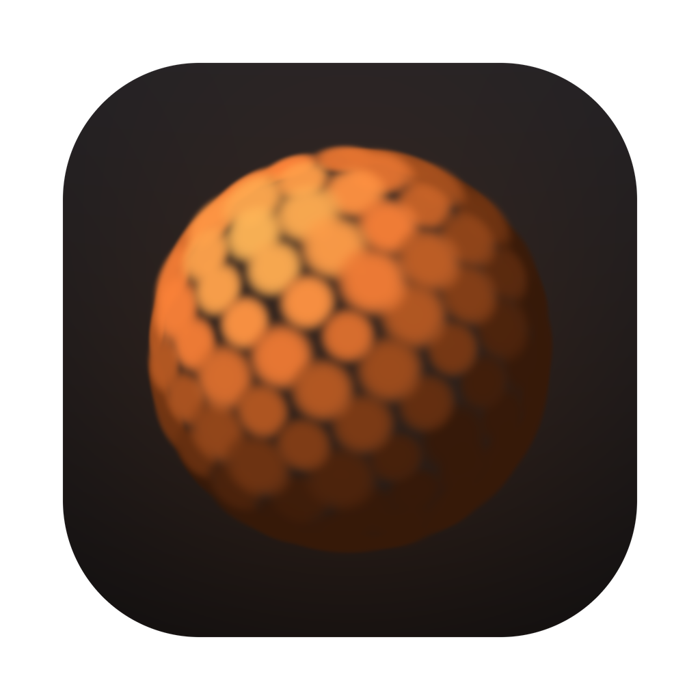
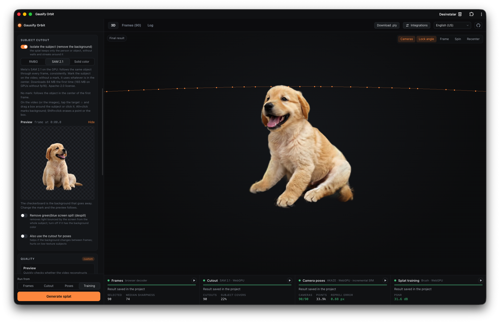

<p align="center">
  
</p>

<h1 align="center">Gausify Orbit</h1>

<p align="center">
  Turn <b>orbit videos</b>, including AI-generated ones, into <b>Gaussian Splats</b>.<br>
  Runs 100% locally, entirely in the browser, on WebGPU.
</p>

<p align="center">
  <a href="https://orbit.gausify.com"></a>
  <a href="https://github.com/obraia/gausify-orbit/actions/workflows/web.yml"></a>
  <a href="docs/web.md"></a>
  
  <a href="LICENSE"></a>
</p>

<p align="center">
  <a href="https://orbit.gausify.com"><b>Try it in the browser</b></a> ·
  <a href="#run-it-locally">Run it locally</a> ·
  <a href="docs/web.md">How the web version works</a> ·
  <a href="LICENSE">MIT License</a>
</p>

<p align="center">
  
</p>

---

Drop in a video that circles around a subject (a person, a product, a sculpture,
or a clip from a video model), and Gausify Orbit extracts the sharpest frames,
optionally cuts out the subject, recovers the camera poses, trains a 3D Gaussian
Splat with live previews and exports a compact `.sog`/`.ply` you can share
with a link. It doesn't need CUDA or an install: everything runs in the browser
on WebGPU.

```
video ──► Frames ──────────► Masking ──────────► Poses ─────────────► Training ───────► splat.ply / .sog / .glb
          browser decode     (optional)          own SfM: AKAZE,       Brush (WASM)
          + sharpest frame   RMBG-1.4,           circular matching     on WebGPU;
          per window         SAM 2.1,            on the GPU, bundle    live previews
                             chroma key          adjustment
```

## Features

- **Orbit-aware frame selection:** samples N×K candidates across the chosen
  range and keeps the sharpest frame of each window, evenly spread around the
  orbit. Image sequences and folders work too.
- **Subject masking:** RMBG-1.4, SAM 2.1 video tracking with box/point prompts
  and a chroma key with despill for green and blue screens. Masked training uses a random
  background, so no ghost silhouettes form around the subject, and edge colours
  are unmixed from the background, so no light fringe forms around hair. The
  optional **Reduce haze** keeps semi-transparent haze off the subject
  when it's seen from new angles.
- **Orbit-aware poses:** an incremental SfM built for orbits (AKAZE features,
  circular matching with long jumps on the GPU, bundle adjustment) that closes
  the orbit, plus inferred poses for frames it can't register. A second
  estimator, **COLMAP**, runs COLMAP's own SIFT and global mapper compiled to
  WebAssembly, with exact SIFT matching on the GPU
  ([colmap-wasm](https://github.com/obraia/colmap-wasm), on npm): steadier
  on AI-generated orbits, at the cost of more memory.
- **GPU training without CUDA:** [Brush](https://github.com/ArthurBrussee/brush),
  pinned to a fixed commit and patched, compiled to WASM + WebGPU. A live 3D viewer
  ([Spark](https://sparkjs.dev)) reloads snapshots as training goes.
- **Optimized export:** PlayCanvas SOG v2 (lossless WebP textures, k-means SH
  palette), decimation that merges similar Gaussians, an opacity floor and
  SH band trimming. Typical output is 5–15× smaller than the raw `.ply`.
- **Mesh export:** a geometric fine-tune of the splat, depth maps fused
  into a sparse TSDF on the GPU, unseen holes closed, simplification and
  feature-preserving smoothing, then a UV atlas and the photos baked into its
  texture: a `.glb` that opens in the 3D view, Blender or three.js.
- **Share by link:** uploads the export to Cloudflare R2 and returns a private,
  expiring `/s/<id>` link with a QR code. It opens in a PlayCanvas viewer with
  touch controls and **VR/AR** (WebXR).
- **Retouch with ComfyUI:** renders the splat along new camera paths,
  restores the clip with a video model in your ComfyUI and fine-tunes the splat
  on the restored frames.
- **Project packages:** save and reopen a whole project as a `.gorbit` file,
  even halfway through a job.
- **UI in English, Portuguese (Brazil) and Spanish.**

## Getting started

Open **[orbit.gausify.com](https://orbit.gausify.com)** in a desktop Chrome or
Edge with WebGPU. The whole pipeline runs in your browser, and videos never
leave your machine. Projects are stored in the browser (OPFS), and the app
works offline after the first visit; Chrome and Edge can also install it as an
app.

### Run it locally

```bash
pnpm install
pnpm web:wasm      # clones Brush at the pinned commit, applies web/brush/*.patch, builds WASM (~5 min)
pnpm web:dev       # http://localhost:1440
```

`web:wasm` needs `rustup` and `wasm-pack`. It installs a side-by-side Rust
1.99 toolchain (Brush's Burn needs ≥ 1.95) without touching `stable`.

See **[docs/web.md](docs/web.md)** for the architecture, what had to be patched
to train in the browser, and benchmarks.

## Usage

1. Drop a video into the window, or drop several images or a folder.
2. If the subject "melts" near the end of the orbit, select a stable range
   with **Start here / End here**.
3. Pick a preset and click **Generate splat**.

Each video gets a project folder in the browser's storage. To rerun only
part of the pipeline, for example with new training settings, use **Run from →
Training**, which reuses the existing frames and poses.

```
<video>_splat/
├── project.json     state (frames, metrics, result)
├── dataset/         Brush input: images/ + sparse/0/
├── masks/           subject masks (grayscale, 255 = subject)
├── dataset_alpha/   when masking: RGBA PNGs + images.bin with .png names
├── training/        intermediate snapshots (keeps the latest 2)
├── splat.ply        final result
└── export/          optimized exports (.sog / .ply / .glb)
```

Images dropped instead of a video are taken in natural name order (`frame2`
before `frame10`), which should follow the orbit. They're rotated according to
EXIF, resized to the preset's max side and must all share the same size, because
the SfM and Brush use a single camera.

## Documentation

| Topic | |
|---|---|
| [Pipeline design notes](docs/pipeline.md) | Why each stage works the way it does, masking methods, export format and measurements |
| [Web version](docs/web.md) | Browser architecture, Brush WASM patches, SAM 2.1, in-browser SfM, benchmarks, Cloudflare deployment |
| [Share links](docs/sharing.md) | R2 storage, the WebXR viewer, expiry and limits, self-hosting the Worker |
| [Mesh export](docs/mesh.md) | Splat → GLB: geometric fine-tune, depth fusion, extraction, hole filling, smoothing, UV and texture bake, and why each choice |
| [Retouch with ComfyUI](docs/retouch.md) | Camera paths, reference rendering, ComfyUI integration and fine-tuning |
| [Development](docs/development.md) | Repository layout, benchmark scripts, tests |

## Tests

```bash
pnpm test:web    # pipeline, SfM, export, mesh, retouch, worker
```

## Acknowledgements and third-party licenses

Gausify Orbit builds on great open-source work:
[Brush](https://github.com/ArthurBrussee/brush) (Apache-2.0),
[Spark](https://sparkjs.dev) (MIT),
[PlayCanvas](https://playcanvas.com) and
[splat-transform](https://github.com/playcanvas/splat-transform) (MIT),
[ONNX Runtime](https://onnxruntime.ai) (MIT),
[OpenCV.js](https://opencv.org) (Apache-2.0),
[Mediabunny](https://mediabunny.dev) (MPL-2.0),
[three.js](https://threejs.org) (MIT),
[meshoptimizer](https://github.com/zeux/meshoptimizer) (MIT) and
[xatlas](https://github.com/jpcy/xatlas) (MIT).
The SOG export is a port of the encoder in WebGaussian.

The segmentation models are downloaded on demand and keep their own licenses:

| Model | License |
|---|---|
| [SAM 2.1 tiny](https://github.com/facebookresearch/sam2) | Apache-2.0 |
| [RMBG-1.4](https://huggingface.co/briaai/RMBG-1.4) (BRIA AI) | **Non-commercial** (opt-in) |

RMBG-1.4 is only downloaded when you select it. Check its license before using
it in commercial work.

## License

[MIT](LICENSE) © Bryan Diniz
